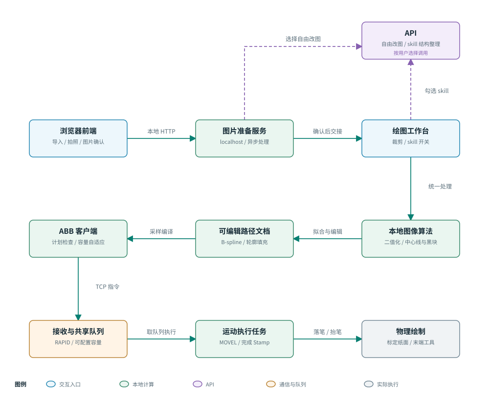

# 小画：面向 ABB 的画像绘制框架

[在线交互图](https://jadenbi.github.io/painting-robot/) · [系统架构](https://jadenbi.github.io/painting-robot/diagrams/interactive/architecture.html) · [处理流程](https://jadenbi.github.io/painting-robot/diagrams/interactive/workflow.html) · [ABB 通信](https://jadenbi.github.io/painting-robot/diagrams/interactive/communication.html)

本项目把照片准备、可选的画像结构整理、局部二值化编辑、可编辑矢量路径和 ABB 执行连接起来。核心研究问题是：如何把包含光影与纹理的肖像，转换为固定笔宽下清楚、可修改、可完整执行的机器人轨迹。

## 演示视频

[观看或下载演示视频](https://media.githubusercontent.com/media/jadenbi/painting-robot/main/%E6%BC%94%E7%A4%BA%E8%A7%86%E9%A2%91.mp4)

## 方法与优化

| 环节     | 采用的方法                               | 解决的问题与效果                             |
| ------ | ----------------------------------- | ------------------------------------ |
| 图片准备   | localhost 浏览器界面、相机/本地导入、自由文本改图、本地抠图 | 把图片选择与创作放在前端，绘图工作台专注图像确认、路径和机器人      |
| 结构整理   | 可选云端图像编辑，加上文件化的条件规则                 | 减少复杂光影和碎线，保留人物与真实配饰；同时保留原图直接二值化的对照流程 |
| 二值化    | 保边滤波、自适应阈值与深色掩膜合并、边缘补全、连通域过滤        | 保留五官与深色主体，减少不必要纹理；自由圈选可单独调节局部        |
| 路径提取   | 距离变换区分粗黑区域、细化与像素图追踪提取线条             | 将单线绘制与黑块填充分开，避免对粗黑区域反复描边             |
| 曲线拟合   | 三次 B-spline、误差检查、异常候选分段重拟合          | 兼顾平滑和形状保持，避免病态拟合造成采样数量爆炸             |
| 区域填充   | 根据当前闭合轮廓构造区域、水平扫描、分块蛇形排序            | 修改轮廓后可重新填充；减少填充过程中的空走                |
| ABB 执行 | 自定义 TCP 二进制协议，按缓冲容量自适应发送            | 小任务沿用边收边画；大任务按批执行确认，规避缓冲写满后丢指令       |

路径优化是启发式策略，不保证全局最短。云端结构整理是生成式编辑，不保证完全不改变五官。当前机器人输出为采样后的 MOVEL 轨迹，ABB 并不直接执行 B-spline 控制点。

## 阅读顺序

1. [系统架构与数据流](docs/architecture.md)：前端、Python 工作台、云端与 ABB 的边界。
2. [图像处理与 skill](docs/image-pipeline.md)：为什么分两条流程，三个滑块如何工作。
3. [路径生成、拟合与填充](docs/path-planning.md)：从二值图到毫米坐标、曲线和填充轨迹。
4. [ABB 通信与发送策略](docs/abb-communication.md)：可配置缓冲容量、自适应发送与执行确认。
5. [部署与常见问题](docs/deployment.md)：Windows 启动、配置、网络超时和控制器要求。
6. [实验验证与待评估指标](docs/validation.md)：已有证据及尚未量化的效果。
7. [结合 ABB 的应用展望](docs/outlook.md)：从平面画像扩展到多场景应用的方向与条件。

## 启动入口

在完整应用工程中，先运行 `SETUP_FACE_WINDOWS.bat`，需要抠图时再运行 `SETUP_MATTING_WINDOWS.bat`。需要使用云端编辑或 skill 时，运行 `CONFIGURE_PAINTING_API.bat` 配置本机密钥。最后运行 `START_FACE_WINDOWS.bat`。

完整条件见[部署说明](docs/deployment.md)。仅打开 `frontend/index.html` 的 file 地址不能替代启动本地服务。文档阅读和离线二值化不需要调用API。

## 框架图与维护

框架图参考 Archify 3.x 交互设计，采用本地实现，支持模块探索、路径追踪与分支演示。提供独立 HTML、可重新生成的 JSON 与绘图源码、SVG/PNG，并保留 Mermaid 关系源码；查看与修改方式见[图表说明](docs/diagrams/README.md)。

## 联系方式

邮箱：[124090004@cuhk.edu.cn](mailto:124090004@cuhk.edu.cn)
