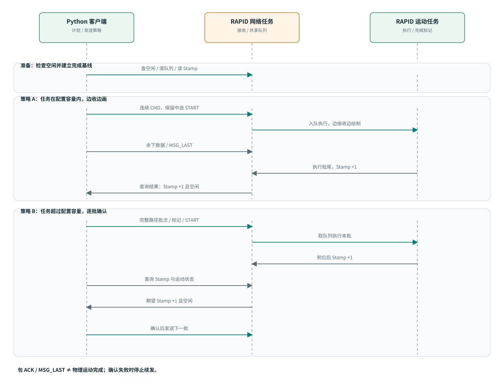

# ABB 通信与发送策略

[返回总览](../README.md) · [下一章：部署](deployment.md)

系统使用自定义 TCP 二进制应用协议与 ABB 通信。在同一协议上，根据任务占用的缓冲条目数选择两种发送策略；并不是切换两套不同网络协议。

## 控制器任务与环形缓冲

配套 RAPID 程序把网络接收与运动执行分为两个任务。网络任务解码数据包，把运动和辅助指令放入共享环形队列；运动任务从队列取出并执行。缓冲容量由 RAPID 中的数组大小和队列实现决定，可根据控制器资源和任务规模调整。在当前以头尾指针区分满/空的实现中，数组预留一个位置，因此可用容量为数组长度减一。它约束的是同时排队、尚未执行的指令数，而不是整幅图允许执行的总步数。

旧接收流程在缓冲已满、入队失败后仍可能给出数据包接收成功反馈。TCP 传输成功或包级 ACK 因此不能证明每条运动已经入队，更不能证明全部执行完毕。长任务持续发送而没有容量约束时，就可能出现绘制到一半提前结束。

该容量是配套 RAPID 程序的实现配置。扩大缓冲可以容纳更多积压指令，但不能消除无限制持续发送导致写满的风险；容量约束与执行确认仍然必要。

## 包格式与指令

客户端位于 `robot_path/abb_legacy_client.py`。报文使用大端整数/浮点参数，分隔标记的字节为 `7f 7f ff ff`；一个包最多 1024 字节。绘图任务通常会拆成多个网络包，所以“单次任务发送”不等于一个网络包。

| 报文类型 | 作用 |
| --- | --- |
| `MSG_CMD` | 携带指令数量和一组运动/控制指令 |
| `MSG_REQ` | 查询完成标记 `GET_STAMP` 或运动状态 `IS_MOVING` |
| `MSG_LAST` | 标记这一轮数据发送结束，不表示物理运动已经完成 |

常用命令包括 `MOVEL`、`CHANGE`、`GO_READY`、`START`、`RESET_BUFFER`、`ADD_STAMP`，以及现有拍照/离纸/盖章命令。`START` 在网络任务中立即设置运行请求，不进入环形队列；其他需排队的指令包含运动、换笔/状态动作和末尾的完成标记。

## 基于可用缓冲容量的自适应策略

客户端先生成完整指令序列，计算需要占用队列的指令数 N（当前实现为所有 `code != START` 的指令），再与两端配置一致的可用容量 C 比较。策略依据任务规模与可用容量的关系选择，不依赖某个固定数字：

| 任务与容量的关系 | 策略 | 目的 |
| --- | --- | --- |
| N ≤ C：任务可在配置容量内容纳 | 保留原流程中途的 START，按网络包持续发送，边收边画 | 小任务在满足原启动条件后即可运动，避免先上传整批再启动的等待 |
| N > C：任务超过配置容量 | 按完整路径边界分批，每批上传后启动并确认，再发送下一批 | 防止未完成指令累积超过可用容量 |

小任务的开始时刻仍受第一条完整路径长度、原 START 插入位置和网络速度影响，不保证点击后立即运动。容量比较的是所有需要排队的指令，包含运动、辅助动作和完成标记，不能只拿 GUI 的路径条数或 MOVEL 点数比较。

大任务按完整路径组织批次，将完成标记等开销计入批次预算，并使排队指令数不超过可用容量。优选批次大小是可调整的发送参数，用于权衡等待与调度开销。为了不在连续落笔路径内部暂停，较长的完整路径可以超过优选批次大小，但必须能安全放入队列；无法容纳的单条路径会被拒绝。下一批要等前一批完成，因此批间可能有等待。这是现有可靠发送策略的代价，不是已经实现了无停顿的滑动窗口流控。

## 如何确认真实执行

新任务先检查 ABB 空闲，再清理旧的待执行队列，并查询初始 Stamp。每批结尾的 `ADD_STAMP` 由运动任务执行，在机器人到位后递增完成标记。客户端必须同时观察到“Stamp 恰好增加 1”和“不在运动”，才确认本批结束并发送下一批。

仅看到包 ACK、`MSG_LAST` 或开始时的 `total number` 不能据此确认完整绘图已经执行。运动任务开始日志中的数量可能只是当时队列中已有的指令数。示教器运动计数与路径条数也不是同一个单位。

小任务边收边画时，若暂时空队列让运动任务退出，而最终标记尚未执行，客户端可只重发 START 来唤醒剩余队列，不重复发送几何指令。大任务未确认完成或网络异常时停止继续发送，不自动重发整批坐标，避免在执行状态未知时重复落笔。

## 等待参数和日志

工作台当前设置总完成等待上限 1800 秒、状态轮询间隔 0.5 秒。长画像在低速下可能需要更长时间，应根据实测总时长调整总等待，而不是修改 AI HTTP 超时。

发送策略、运行文件路径、指令数、批次和 Stamp 记录打印到 CMD。没有增加工作台上的通信进度文字。发生中断时，保留 CMD 和示教器记录，以确定最后确认的批次；当前没有实现任意节点的自动断点续画。

## 当前配置示例与调整条件

当前本地 RAPID 的数组长度为 8192，可用容量为 8191，Python 优选批次大小为约 2000 条；这些数值是当前实现的参数，不是方法本身的固定要求。调整容量时，需要同步核对 RAPID 指令/参数数组、共享任务定义，以及 Python 的安全阈值和批次检查，并确认控制器资源与运行结果。当前客户端不会自动查询并同步控制器的缓冲容量。

容量约束解决的是队列溢出这一类中途停止问题。网络断线、控制器报警、工作面或工具标定错误仍需分别排查，不能由此宣称所有停画原因都已消除。
