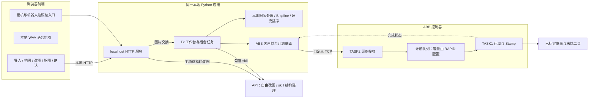
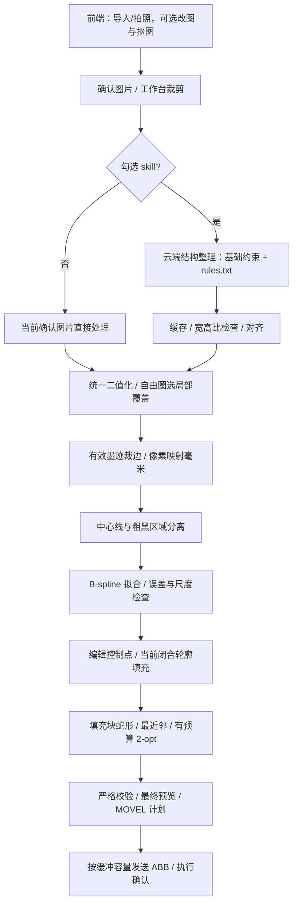
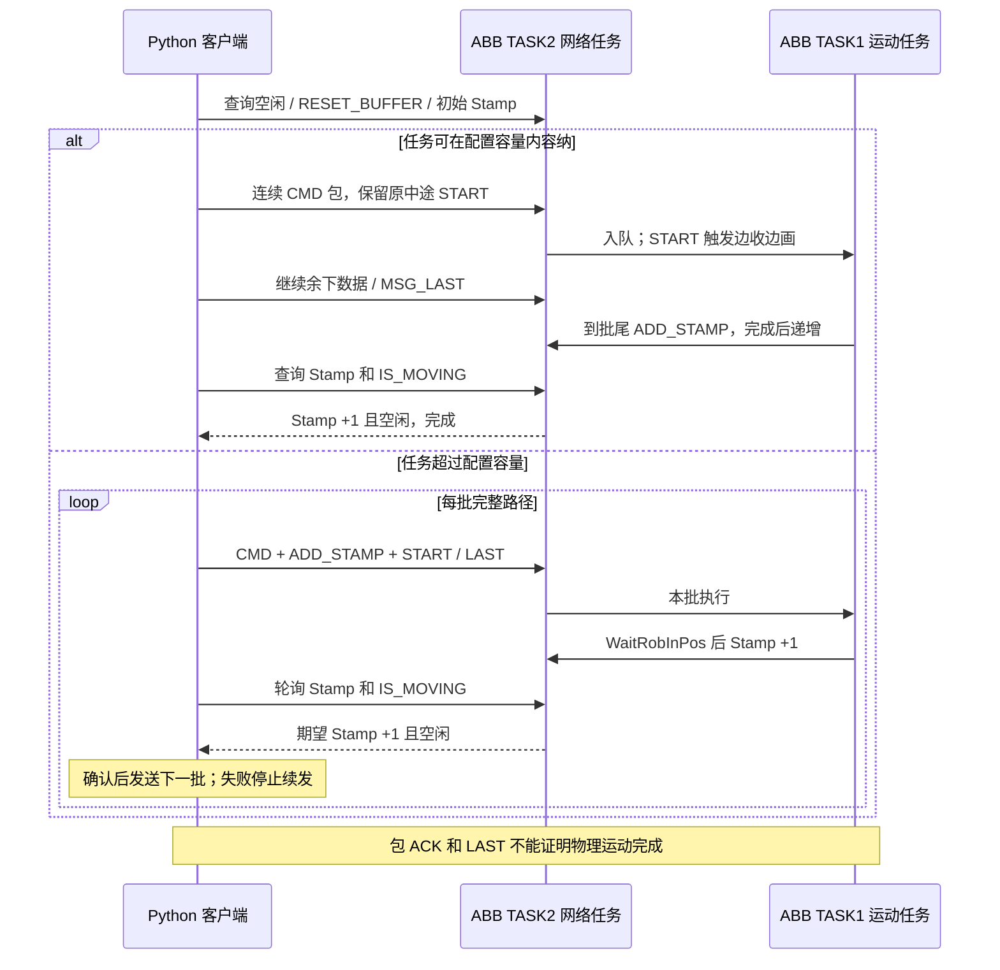

# 交互框架图使用说明

[返回项目总览](../../README.md)

本项目提供三张交互图，帮助读者了解系统组成、图片处理与路径规划，以及 ABB 通信流程。查看图表只需要浏览器，无需安装 Python、配置 API 或连接机器人。图表支持在线访问，也支持下载后离线打开。

## 选择要查看的图

| 图表 | 内容 | 交互 HTML 文件 | 静态图片 |
| --- | --- | --- | --- |
| 系统架构 | 浏览器前端、Python 工作台、API 与 ABB 之间的关系 | [architecture.html](interactive/architecture.html) | [SVG](../images/architecture.svg) · [PNG](../images/architecture.png) |
| 图片处理与路径规划 | 图片确认、可选 skill、二值化、曲线拟合、填充与路径输出 | [workflow.html](interactive/workflow.html) | [SVG](../images/workflow.svg) · [PNG](../images/workflow.png) |
| ABB 通信 | 根据配置的缓冲容量选择连续发送或分批确认 | [communication.html](interactive/communication.html) | [SVG](../images/communication.svg) · [PNG](../images/communication.png) |

上表的 HTML 链接指向仓库文件。在 GitHub 仓库中点击时，通常会进入源码页面；要直接体验交互，请使用项目发布的 GitHub Pages 链接，或按下面的方法下载到本地打开。

## 在线查看

如果项目首页提供“在线交互图”链接，点击后即可在浏览器中操作，无需下载。在线版通过 GitHub Pages 发布，和本地 HTML 版具有相同的交互功能。

若首页暂未提供在线链接，可以先使用离线方式。GitHub 的 README 和普通文件预览页不会运行这些 HTML 中的交互脚本；静态 SVG/PNG 用于直接阅读和插入报告。

## 下载后离线查看

1. 在 GitHub 仓库首页选择 **Code → Download ZIP**，下载后解压。
2. 进入项目目录中的 `docs/diagrams/interactive/` 文件夹。
3. 用 Edge、Chrome 等浏览器打开 `architecture.html`、`workflow.html` 或 `communication.html`。如果双击打开的是代码编辑器，右键文件，选择“打开方式 → 浏览器”。

这三个 HTML 都已内嵌图形、样式、数据和交互脚本，可以分别保存后独立打开。若只下载单个 HTML，请使用 GitHub 文件页面的 **Download raw file** 下载文件，不要把 GitHub 的源码预览网页另存为图表。

在 Obsidian 中，可直接阅读文档内的静态图；体验交互时，请从系统文件资源管理器中用浏览器打开 HTML。

## 如何操作交互图

| 想做什么 | 操作方法 |
| --- | --- |
| 查看模块或连接含义 | 点击节点或连线，在右侧查看详情；也可搜索模块名称。 |
| 查看前后关系 | 在系统架构图、处理流程图中选择节点，再点击“上游”或“下游”。 |
| 按步骤讲解 | 先选择“演示分支”，再点击“下一步”“上一步”或“播放”。播放到末步会停止。 |
| 比较不同流程 | 处理流程图可选择使用/不使用 skill；通信图可选择容量内连续发送/超过容量分批确认。 |
| 放大或移动 | 点击“＋”“−”，或按住 Ctrl 滚动鼠标滚轮；拖动图中空白处平移。“适合窗口”恢复视野。 |
| 全屏式讲解 | 点击“演示模式”简化页面；左右方向键切换步骤，Esc 退出并恢复完整图。 |
| 恢复初始显示 | 点击“完整图”，清除当前高亮并恢复视野。 |
| 更换配色 | 点击“深色”或“浅色”，切换图表主题。 |

架构图和处理流程图还支持选择起点、终点来追踪图中已有的有向连接。这里的路径追踪用于解释模块关系，与机器人的运动路径优化不同。通信图按照消息先后顺序演示。所有高亮均为文档演示，不代表机器人实时状态，也不会向机器人发送指令。

## 开源来源

交互图参考 Archify 3.x 的交互设计，由本项目本地实现。复用与修改时请保留 [来源与功能范围](interactive/THIRD-PARTY-NOTICE.md) 和 [许可文件](interactive/ARCHIFY-LICENSE.txt)。已有检查记录见 [构建记录](interactive/build-report.json)、[交互测试记录](interactive/test-report.json) 和 [验证记录](interactive/validation.json)。

## 系统架构：

## 处理流程

## ABB 通信

