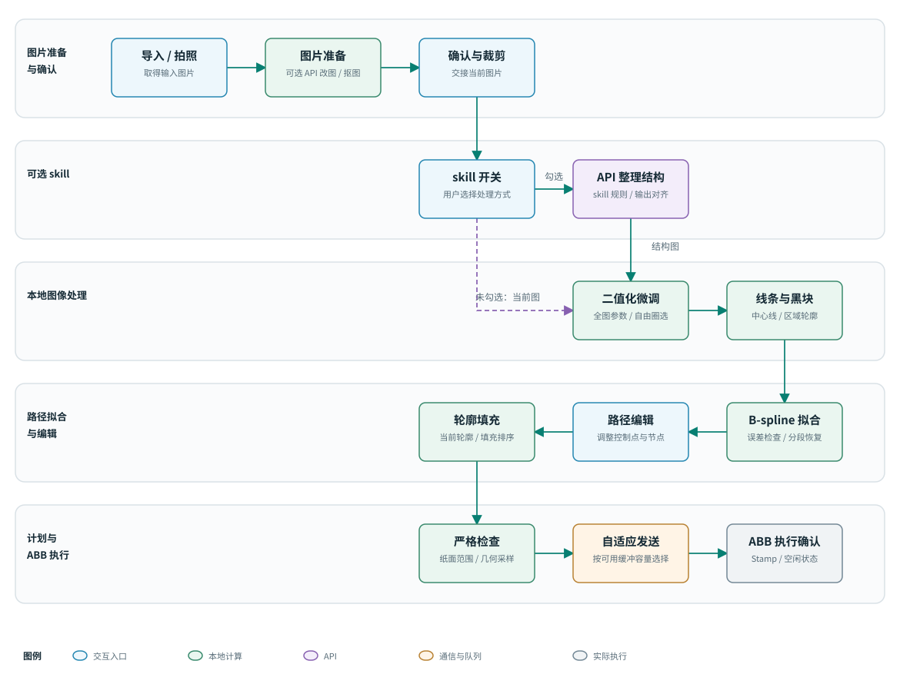

# 图像处理与 skill

[返回总览](../README.md) · [下一章：路径规划](path-planning.md)

图像处理分为“用户想要什么图片”和“这张图片如何变成可绘制结构”两个阶段。前端自由文本编辑负责前者，工作台的 skill 开关负责后者。这样可以把创作需求与机器人绘图约束分开。

## 前端图片准备

用户可本地导入或相机拍摄，再输入简短的修改要求，例如“把照片中的人变成女生，保留原来的表情和衣服”。自由文本编辑通过 API 完成，只追加一条尽量保留人物辨识度与其余画面的短约束，并关闭额外提示扩展与额外推理，减少不必要的请求内容。

抠图在本地推理完成，可根据前景透明度进行背景合成。运行资源需提前准备；有兼容设备时可用 CUDA，也可用 CPU。该步骤与通过 API 改图是不同功能。

“小画”语音使用已生成并保存在工程中的固定 WAV 提示。语音素材预先通过 API 生成。运行时播放本地文件，不是实时语音识别、实时对话或每次调用 TTS。

## skill 开关的两条流程

| 状态  | 工作台输入如何处理             | 相同的后续步骤                 |
| --- | --------------------- | ----------------------- |
| 不勾选 | 当前确认并裁剪的图片直接进入本地二值化   | 二值化微调 → 路径初稿 → 编辑 → ABB |
| 勾选  | 当前图片先经云端结构整理，再进入本地二值化 | 二值化微调 → 路径初稿 → 编辑 → ABB |

不勾选不会为结构整理调用 AI。前端如果曾主动做过 AI 改图，工作台此时处理的是用户确认的那张结果图，不能把“不勾选 skill”误解成撤销前端已发生的 AI 编辑。

结构整理通过 API 完成，并使用 skill 规则约束输出。基础提示负责人物、姿态、构图和配饰的保留，`rules.txt` 负责追加画像绘制约束。工程中的 `SKILL.md` 供开发/维护者阅读，运行程序实际拼接的规则文本是 `rules.txt`；修改 `SKILL.md` 不会自动改变生成提示。

规则把头发概括为自然黑块和必要发束，眉毛保留原厚度与眉形并减少碎毛。眼部条件分为互斥的三种情况：没有眼镜就不添加；透明眼镜保留可见眼睛；墨镜保留深色镜片，不补画被遮住的眼睛。这些是生成约束，不是后处理程序给每个人画上同一副镜框。

结构结果按图像内容、尺寸、提示、skill 规则、API 配置和版本生成缓存键。修改规则或输入图像后会对应不同缓存。输出需要检查宽高比与输入是否一致，随后对齐到输入坐标；对齐不是恢复 AI 已丢失的细节。用户仍应对照五官、眼镜、发际线与构图。

## 二值化方法

`portrait_binarize()` 在输入分辨率上处理，最后输出严格的 0/255 图像。主要过程是：

1. 用双边滤波抑制光影纹理，尽量保留明显边缘；去噪较高时加一次 3×3 中值滤波。
2. 用局部高斯自适应阈值提取局部结构，同时用全局深色阈值保留黑色主体。两种墨迹掩膜取并集。
3. 从平滑图中提取 Canny 边缘，补充部分长轮廓，再做小核闭运算连接短缺口。
4. 根据连通域面积和跨度去除很小的孤立碎片，输出黑白图。

这种组合避免单一全局阈值把光照较暗的脸部全部涂黑，也避免只提边缘使头发和深色镜片变成空心线条。阈值及形态学操作仍可能损失浅线或连接相邻细节，需要局部微调。

## 三个滑块如何实现

参数范围均为 0～100，当前函数默认去噪 65、细节 45、补全 55。已保存的设置可能改变初始值。

| 参数 | 实现 | 调高的典型影响 |
| --- | --- | --- |
| 去噪强度 N | 双边核直径为 5/7/9；颜色标准差 `18+0.55N`，空间标准差 `3+0.05N`；N≥70 时加中值滤波；后续碎片过滤也参与 | 减少纹理和散点，也可能减少细发丝等真实细节 |
| 细节保留 D | 自适应阈值常数 `C=13-0.12D`；深色阈值约为 `58+0.32D`；也影响补全的边缘阈值 | 更多浅线和深色像素进入墨迹，同时可能保留肤质噪声 |
| 轮廓补全 K | K>0 时合并边缘；Canny 高阈值约为 `190-0.6K-0.2D`，限制在 70～220，低阈值约为其 0.42 倍，并执行闭运算 | 有利于短缺口连接，也可能粘连眼部、镜框或衣纹 |

二值化是滤波、阈值、边缘与连通域方法，不是额外的人脸语义识别器。中央区域的过滤保护是位置规则，不能称为检测到了某个五官。

## 自由圈选与局部覆盖

鼠标默认拖动图像；点“框选”后，拖动绘制自由轮廓，松开鼠标自动闭合并生成区域掩膜。滑块仅修改该区域。滚轮缩放，取消选区回到移动操作。

内部保存一个全图二值基底和一个局部覆盖层，覆盖层以 -1 表示未修改、0/255 表示局部结果。局部调节从源图重新计算候选结果，只把掩膜内像素写入覆盖层；全图调节重算基底，保留局部修改。撤销按一次操作记录局部变化，使连续拖动滑块不会产生大量独立撤销步骤。

两种 skill 状态使用同一套二值化和编辑实现。勾选 skill 后的局部调节基于结构图，因此无法通过滑块找回 AI 在结构图中删掉的眼镜或改变的五官；这类问题应回到结构整理阶段修正规则或结果。
